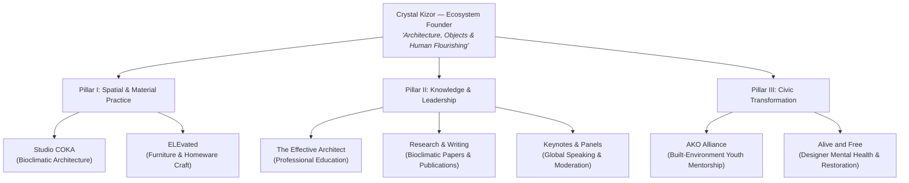

# Crystal Kizor — Architecture, Objects & Human Flourishing

[](tests/)
[](vite.config.js)
[](AGENTS.md)
[](https://crystal-kizor-coka-studio.vercel.app)
[](#)

> A unified personal brand ecosystem and digital portfolio for **Crystal Kizor** — Architect, Designer, Researcher, and Ecosystem Founder. Built with Vanilla JavaScript (ES Modules), custom CSS design tokens, Apple design physics, and strict sub-second performance.

🚀 **Live Application:** [crystal-kizor-coka-studio.vercel.app](https://crystal-kizor-coka-studio.vercel.app)

---

## 🌐 Live Production & Demo

| Environment | Status | URL |
| :--- | :--- | :--- |
| **Production Deployment** | 🟢 Live | [crystal-kizor-coka-studio.vercel.app](https://crystal-kizor-coka-studio.vercel.app) |
| **Local Development** | Active | `http://localhost:5173` |
| **Automated Test Suite** | 100% Passing | 9 Test Files / 65 Unit & Component Tests |

---

## 📑 Table of Contents

- [Submission Short Note](#submission-short-note)
- [Part 1: Web Ecosystem Architecture & Engineering](#part-1--web-ecosystem-architecture--engineering)
  - [Ecosystem Thesis & Pillar Architecture](#ecosystem-thesis--pillar-architecture)
  - [Apple Design System Implementation](#apple-design-system-implementation)
  - [Core Interactive Components](#core-interactive-components)
  - [Performance & Asset Pipeline](#performance--asset-pipeline)
  - [Test Suite & Quality Assurance](#test-suite--quality-assurance)
  - [Developer Quickstart & Commands](#developer-quickstart--commands)
  - [Project File Structure](#project-file-structure)
- [Part 2: AI Product Thinking](#part-2--ai-product-thinking)
  - [Studio COKA: Bioclimatic Architecture Assistant](#studio-coka-bioclimatic-architecture-assistant)
- [Part 3: Analytics & Improvement](#part-3--analytics--improvement)
  - [Measuring Website Performance](#measuring-website-performance)
  - [Scenario: 5,000 Visitors, 5 Enquiries (0.1% CVR)](#scenario-5000-visitors-5-enquiries-01-cvr)

---

### SUBMISSION SHORT NOTE
*(Word count: 188 words — limit: ≤ 200 words)*

#### **Landing Page Design & Engineering Note**

**Thinking & Concept:**  
Crystal Kizor is not merely an architect running separate businesses, but an ecosystem founder whose work unites physical architecture, built-environment education, and human restoration under one thesis: *“Architecture, Objects, & Human Flourishing.”* To prevent cognitive overload across seven distinct initiatives, I organized the ecosystem into three cohesive pillars (Spatial & Material Practice, Knowledge & Thought Leadership, Civic Transformation) anchored by an interactive **“Choose Your Journey” Wayfinder**. This immediately segments visitors into clients, keynote curators, architects, and civic partners routing them to tailored deliverables and pre-filtered inquiry states.

**Key Decisions & Craft:**  
- **Apple Design Philosophy:** Implemented fluid physics-based motion, zero-latency pointer feedback, translucent glassmorphic surfaces, and seamless project inspection sheets with photo gallery, effectively portraying Apple's design philosophy effortlessly.  
- **CVR friendly contact form:** Connected interactive exploration directly to a dynamic, intent-aware Inquiry Suite.  

**Technology Choice:**  
Built with **modern Vanilla JavaScript (ES Modules), semantic HTML5, and custom CSS design tokens**, bundled via **Vite**. Avoiding too much complexity for a single page web app and bloated client-side frameworks achieved near-instant sub-second initial loads, zero cumulative layout shift (CLS), speculative prefetching for modal assets, responsive WebP image sets with `fetchpriority`, and robust automated test coverage with Vitest (65/65 passing tests).

---

## Part 1: Web Ecosystem Architecture & Engineering

### Ecosystem Thesis & Pillar Architecture

To present Crystal Kizor’s multidisciplinary impact without confusing the visitor or diluting her identity, the architecture organizes 7 ventures across 3 distinct pillars:



---

### Apple Design System Implementation

The user experience strictly adheres to Apple Human Interface Guidelines and fluid physical motion:

1. **Zero-Latency Response**: Direct tactile feedback on `pointerdown` via hardware-accelerated transforms (`transform: scale(0.98)`), never waiting for click or release.
2. **Interruptible Physical Motion**: Fluid spring parameters (`damping: 1.0`, `response: 0.35s`) eliminate mechanical easing curves and allow real-time gesture interruptions.
3. **Materials, Depth & Translucency**: Floating glassmorphic surfaces (`backdrop-filter: blur(20px) saturate(180%)`) layering over dark and light alabaster backdrops (`var(--color-alabaster-100)` and `rgba(18, 19, 22, 0.85)`).
4. **Direct Manipulation**: Gallery modal sheets support smooth touch gestures, drag-to-dismiss, and keyboard shortcuts (`Escape`, `ArrowLeft`, `ArrowRight`).
5. **Accessibility & Reduced Motion**: Full support for `prefers-reduced-motion: reduce` with gentle opacity cross-fades replacing spatial displacement.

---

### Core Interactive Components

| Component | File | Key Capabilities |
| :--- | :--- | :--- |
| **"Choose Your Journey" Wayfinder** | [`Wayfinder.js`](src/components/Wayfinder.js) | Segmenting cards (Clients, Curators, Architects, Civic) that auto-scroll to the inquiry section and pre-fill form intents. |
| **Dynamic Inquiry Suite** | [`InquirySuite.js`](src/components/InquirySuite.js) | Intent-aware inquiry form featuring real-time pill selection, validation feedback, and automated calendar/WhatsApp handoff. |
| **Project Inspection Dialog** | [`GalleryModal.js`](src/components/GalleryModal.js) | Full-screen immersive modal with high-res galleries, keyboard arrow navigation, swipe gestures, thumbnail strip, and focus trapping. |
| **Universal Clickable Cards** | [`ClickableCards.js`](src/components/ClickableCards.js) | Seamless click handling across projects, initiatives, and publications with nested button event separation. |
| **Scroll Reveal & Parallax** | [`ScrollReveal.js`](src/components/ScrollReveal.js) / [`Parallax.js`](src/components/Parallax.js) | Bidirectional viewport reveals and subtle depth layers driven by `IntersectionObserver`. |

---

### Performance & Asset Pipeline

- **Speculative Modal Prefetching**: When a user hovers (`pointerenter`) or focuses a project trigger, `GalleryModal.js` dynamically pre-downloads the JavaScript chunk before the click event even fires.
- **Responsive Multi-Density Images**: All photographs pre-processed with `sharp` into modern WebP variants (`480w`, `800w`, `1200w`) with `fetchpriority="high"` for hero candidates.
- **Zero CLS (Cumulative Layout Shift)**: Explicit image dimensions (`width` / `height` attributes) and responsive aspect ratios ensure layout stability.
- **Production Bundle Efficiency**: Built output is under `100 kB` total gzipped for the entire application, stylesheet, and all dynamic chunks combined.

---

### Test Suite & Quality Assurance

The codebase includes an automated test suite configured with **Vitest** and **happy-dom**:

```bash
✓ tests/inquirySuite.test.js (4 tests)
✓ tests/wayfinder.test.js (2 tests)
✓ tests/galleryModal.test.js (6 tests)
✓ tests/clickableCards.test.js (9 tests)
✓ tests/smoothScroll.test.js (8 tests)
✓ tests/scrollReveal.test.js (10 tests)
✓ tests/navigation.test.js (3 tests)
✓ tests/data.test.js (8 tests)
✓ tests/gestures.test.js (15 tests)

Test Files  9 passed (9)
     Tests  65 passed (65)
```

---

### Developer Quickstart & Commands

#### Prerequisites
- **Node.js** (v18.0.0 or higher recommended)
- **npm** (bundled with Node)

#### Installation
```bash
# Clone the repository
git clone https://github.com/joetechster/Crystal-Kizor.git
cd "Crystal-Kizor"

# Install dev dependencies
npm install
```

#### Running the Application Locally
```bash
# Start the Vite development server (hot-reloading enabled)
npm run dev
# Open http://localhost:5173 in your browser
```

#### Running Automated Tests
```bash
# Run Vitest test suite once
npm test

# Run tests in watch mode
npm run test:watch
```

#### Building for Production
```bash
# Compile and optimize production assets into /dist
npm run build

# Preview production build locally
npm run preview
```

---

### Project File Structure

```
Crystal-Kizor/
├── .agents/                    # Custom agent skills (Apple design guidelines)
├── public/                     # Static assets (favicons, site manifest, icons)
│   ├── assets/                 # Optimized WebP responsive photos & portraits
│   └── site.webmanifest
├── src/
│   ├── components/             # Reusable ES Modules
│   │   ├── ClickableCards.js   # Universal card interaction handler
│   │   ├── GalleryModal.js     # Modal viewer, lightbox & gestures
│   │   ├── InquirySuite.js     # Form validation & intent router
│   │   ├── Navigation.js       # Sticky translucent header & mobile menu
│   │   ├── Parallax.js         # Subtle depth effects
│   │   ├── PointerFeedback.js  # Zero-latency tactile feedback
│   │   ├── ScrollReveal.js     # Bidirectional scroll animations
│   │   ├── SmoothScroll.js     # Physics-assisted anchor scrolling
│   │   └── Wayfinder.js        # Journey routing controller
│   ├── data/
│   │   └── projectsData.js     # Structured project metadata & gallery items
│   ├── styles/
│   │   ├── tokens.css          # Color tokens, typography, shadows, radii
│   │   └── main.css            # Component styles & responsive layouts
│   └── main.js                 # Application entry point & code-splitting
├── tests/                      # Automated Vitest component & gesture tests
├── index.html                  # Semantic HTML5 entry document
├── package.json                # Project dependencies & scripts
├── vercel.json                 # Vercel caching headers & deployment config
├── vite.config.js              # Vite bundler configuration
└── vitest.config.js            # Test runner environment configuration
```

---

### PART 2: AI PRODUCT THINKING

#### **Studio COKA: Bioclimatic Architecture Assistant**

**What it does & Who it is for:**  
An interactive web copilot for prospective clients, property developers, and homeowners planning residential or commercial projects in tropical and sub-Saharan climates. It translates site coordinates, orientation, and lifestyle goals into a customized feasibility brief that recommends adequate cooling, solar orientation, and building material strategies before their initial architect consultation.

**The Problem It Solves:**  
Clients frequently default to energy-inefficient, glazed building concepts that incur massive operational cooling costs. Lacking architectural literacy, they struggle to articulate climate-responsive requirements or evaluate bioclimatic trade-offs during early project scoping.

**User Experience:**  
Users input their plot location, orientation, and lifestyle priorities with an option to upload site photos. The tool queries local solar paths and prevailing breezes to generate tailored recommendations like an optimal window-to-wall ratio, ect. Users can download the brief or submit it directly into Studio COKA’s commission pipeline.

**Technology & Architecture:**  
Powered by **Google Gemini 2.0 Flash** because of its rapid multimodal spatial reasoning and near-zero latency via structured JSON schema outputs to prevent parsing errors. The system will pair Gemini with the **Open-Meteo Climate API** used to retrieve historical solar radiation, wind rose, and humidity data and perform RAG on a vector database indexing Studio COKA’s data and catalog to give it better context.

**First Working Version (MVP):**  
A lightweight responsive web module embedded directly into the ecosystem site. A serverless API queries microclimate data, feeds structured prompts to Gemini Flash, and renders interactive 2D orientation diagrams with a one-click PDF summary generator and consultation scheduler.

**Risks & Safeguards:**  
- **Disclaimer Guardrails:** Prominently notes that outputs represent schematic feasibility, not stamped engineering calculations.  
- **Hallucination Controls:** Strict schema enforcement and temperature calibration prevent fabricated building codes.  
- **Data Privacy:** Uploaded client surveys and plots are processed without persistent storage.

---

### PART 3: ANALYTICS & IMPROVEMENT

#### **Measuring Website Performance**

A high-performing website balances technical speed, visitor engagement, and business conversion.
- **What to Track:**  
  - *Macro-Conversions:* Commission inquiries, keynote requests, and form completion rates.  
  - *Micro-Engagement:* Wayfinder pathway selection, project gallery inspections, time on page, and scroll depth.  
  - *Technical Health:* Core Web Vitals (LCP < 1.2s, INP < 100ms, CLS = 0) and mobile bounce rates.
- **Tools:** GA4 for conversion funnels and user pathways; Microsoft Clarity for heatmaps, rage clicks, and session replays; Google Search Console for organic keyword intent.
- **Data-Driven Improvement:** Funnel drop-off data pinpoints UX friction; heatmaps reveal whether visitors interact with primary CTAs or stall on non-interactive elements, informing targeted A/B tests.

---

#### **Scenario: 5,000 Visitors, 5 Enquiries (0.1% CVR)**

To diagnose this severe conversion bottleneck, I would investigate three vectors:

1. **Technical & Device Audit:** Segment conversion rates by device and browser in GA4. Is the inquiry form failing on iOS Safari, throwing unhandled JavaScript exceptions, or suffering from slow mobile load times (>3.5s)?
2. **Behavioral Friction:** Inspect Clarity session recordings and drop-off funnels. Are users abandoning midway due to form field fatigue? Are rage clicks occurring on unlinked cards? Are visitors bouncing before reaching the inquiry section?
3. **Traffic Intent:** Audit acquisition channels in Search Console. Is traffic driven by irrelevant informational queries or bot spikes lacking commercial intent?

**Next Steps:**
Improvements should be carried out based on findings from analysis, some examples may include the following.
- Chrome Lighthouse to audit and cleanup client-side technical debt.
- Streamline the form into a progressive two-step flow pre-filled with the visitor's selected Wayfinder intent.
- Introduce trust anchors which may typically be client testimonials or direct WhatsApp/calendar booking.
- Implement a sticky mobile inquiry action bar.
